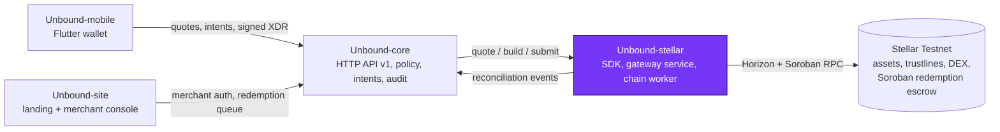

<div align="center">


# Unbound-stellar

**The Stellar layer of Unbound: issuer and trustline checks, path quotes, unsigned transaction builders, a gateway service, a chain worker, and the one Soroban contract, the redemption escrow.**

[](https://github.com/Unbound224/Unbound-stellar/actions/workflows/ci.yml)
[](https://github.com/Unbound224/Unbound-stellar/actions/workflows/contracts.yml)
[](./LICENSE)
[](https://developers.stellar.org/docs/networks)
[](#tech-stack)

[Docs](https://github.com/Unbound224/Unbound-site/tree/main/gitbook) · [Live site](https://unbound-web1.vercel.app) · [Quick start](#quick-start) · [Architecture](./docs/ARCHITECTURE.md) · [Contract on Stellar Expert](https://stellar.expert/explorer/testnet/contract/CC4ETHM44IUJ4GDRT57VH4OSNEMPEGUKQHQJCUQDIU2LKIAKZYIYOP6C) · [Contributing](./CONTRIBUTING.md)

</div>

## What this is

Store credit is usually stuck inside one retailer. Unbound lets a person exchange store credit that a retailer has issued
and agreed to honor for other Stellar assets, at a real order-book quote that they sign on their own device, or redeem it with
the issuer. This repository is the part that touches the ledger. It checks issuer accounts and trustlines, finds strict-send
paths, builds unsigned transactions, submits them, and reconciles the outcome by hash. It also holds Unbound's only smart
contract: an escrow that keeps returned credit safe until the issuer confirms, rejects, or the deadline passes.

Unbound is a Testnet prototype. It has had no security audit and holds no real funds.

## Status

| Piece | State | Evidence |
|---|---|---|
| Redemption escrow contract (Soroban, `soroban-sdk` 29.0.1) | Deployed on Testnet | [`CC4ETHM4...YOP6C`](https://stellar.expert/explorer/testnet/contract/CC4ETHM44IUJ4GDRT57VH4OSNEMPEGUKQHQJCUQDIU2LKIAKZYIYOP6C), wasm hash `37726f8c...c415a`, deployed 2026-11-04 |
| Deploy transactions | Successful on Horizon | [upload](https://stellar.expert/explorer/testnet/tx/f4c594da02264172e2cc7e325622329e8d2820f8abc5680c07057a82a0d7be12) · [deploy](https://stellar.expert/explorer/testnet/tx/1c827ee3ed78890545716540160f2e87b1f81b0b8cb5e3d2461e2ca246aac36f) · [init](https://stellar.expert/explorer/testnet/tx/23e600cd69599455b7be3b016925b925198d8960f1c9d06df620bb73e0c081be) |
| Escrow smoke run | open/confirm, open/reject, replayed id refused (error #6), early refund refused (#9), refund after the deadline | [confirm](https://stellar.expert/explorer/testnet/tx/8af95ad4e234b4e14721f39198d464a958900b578c8870c570eef6a8a0a51c05) · [reject](https://stellar.expert/explorer/testnet/tx/3a05c7b222cb02752cf2fc968d2ec263c20e438a8a6069e960ad81bea4320b07) · [expiry refund](https://stellar.expert/explorer/testnet/tx/191ab9aceee9d05c6426024064a0d2c641bc456a6bcb3bf38b52c671d0c401a4) |
| Core to gateway to escrow, end to end | Confirm, reject and holder timeout refund landed | [return](https://stellar.expert/explorer/testnet/tx/0c9b01b583a68df7a6123c1439ec29fa92375eedba41ae78cc899a9727d8f0d2) · [confirm](https://stellar.expert/explorer/testnet/tx/92eab2cd492451d1e34669d8c0d97a853d806cf6f99399630ae03af29bf258fa) · [timeout refund](https://stellar.expert/explorer/testnet/tx/57eef54681b43d3164e3feb9449f9f8d0154475aabbba03a59a0118101a8c4d8) |
| Exchange SHOP to USDC through the DEX | Quote, intent, signed settlement, confirmed | [settlement](https://stellar.expert/explorer/testnet/tx/5879422d5f67f3388f26f525a7cadaa9640eaa1c521fed272de3fc3dfbe775e1) |
| Hosted gateway | Running on a free Render instance (development entrypoint) | `https://unbound-gateway.onrender.com`, answers 401 without its bearer token |
| Tests | 128 TypeScript tests (12 files) and 24 contract tests, plus golden XDR fixtures shared with the mobile decoder; `npm run check` exits 0 | CI badges above |
| On-chain rejection of a wrong signer | Not demonstrated; the smoke run's wrong-signer rows were refused by `stellar-cli` before submit | Contract auth is covered by the Rust tests |
| Account-stream indexing, escrow events from RPC, liquidity pools, reserves and liabilities | Not built | [Open issues](https://github.com/Unbound224/Unbound-stellar/issues) |
| External audit, published package, Docker image, fee sponsorship | Not done | |

Every hash above was checked as `successful` on Horizon. The full log, with the deploy script output, is in
[`docs/DEPLOYMENT.md`](./docs/DEPLOYMENT.md) and the raw JSON is in [`contracts/deployments/`](./contracts/deployments).

## How it fits together



Clients never build Stellar transactions, and core never reimplements ledger logic.

| Repository | Owns | CI |
|---|---|---|
| [Unbound-core](https://github.com/Unbound224/Unbound-core) | Backend API: issuers, policies, intents, redemptions, audit | [](https://github.com/Unbound224/Unbound-core/actions/workflows/ci.yml) |
| [Unbound-stellar](https://github.com/Unbound224/Unbound-stellar) (this repo) | Stellar SDK, gateway service, chain worker, Soroban escrow | [](https://github.com/Unbound224/Unbound-stellar/actions/workflows/ci.yml) |
| [Unbound-site](https://github.com/Unbound224/Unbound-site) | Landing page, merchant and reviewer consoles, GitBook source | [](https://github.com/Unbound224/Unbound-site/actions/workflows/ci.yml) |
| [Unbound-mobile](https://github.com/Unbound224/Unbound-mobile) | Flutter consumer wallet | [](https://github.com/Unbound224/Unbound-mobile/actions/workflows/ci.yml) |

Why Soroban is used in exactly one place: [ADR 0002](./docs/adr/0002-soroban-redemption-escrow.md). Everything else uses
classic Stellar operations, because path payments, trustlines and issuer authorization already do the job.

## Tech stack

| Layer | Choice |
|---|---|
| SDK, gateway, worker | TypeScript, Node 22+, `@stellar/stellar-sdk`, zod |
| Contract | Rust, `soroban-sdk` 29.0.1, target `wasm32v1-none` |
| Ledger access | Horizon and Soroban RPC (Testnet only; any other passphrase is refused) |
| Tests | Vitest, `cargo test` with a seeded invariant test, golden Rust to TypeScript XDR fixtures |

## Quick start

Requires Node 22+.

```bash
npm ci
npm run check                      # lint + typecheck + tests + build
npx tsx scripts/m1-demo.ts         # offline demo: issue, quote, settle, and a refused no-trustline route
```

The demo runs on `SimulatedLedger`, an in-memory test adapter that verifies real XDR signatures, sequence numbers and time
bounds. Its hashes are not Testnet hashes.

The contract (Rust stable plus the `wasm32v1-none` target; on Windows use the MSVC toolchain):

```bash
cd contracts
cargo fmt --check && cargo clippy --all-targets -- -D warnings && cargo test
cd ..
DRY_RUN=1 scripts/deploy-testnet.sh   # prints the stellar-cli steps; drop DRY_RUN to deploy for real
```

Run the gateway against Testnet (needs your own random `GATEWAY_TOKEN` of 16+ characters):

```bash
export GATEWAY_TOKEN=<random 16+ chars> ESCROW_CONTRACT_ID=CC4ETHM44IUJ4GDRT57VH4OSNEMPEGUKQHQJCUQDIU2LKIAKZYIYOP6C
npm run gateway                    # http://127.0.0.1:3002, Horizon + Soroban RPC on Testnet
```

See [`.env.example`](./.env.example) for every variable. The live scripts are [`scripts/testnet-smoke.ts`](./scripts/testnet-smoke.ts) (escrow
paths on Testnet using `stellar keys` aliases, never raw secrets) and `scripts/deploy-testnet.sh`.

## Project structure

```text
src/            SDK: amounts, registry, quotes, builders, settlement, indexer, gateway server, worker, Soroban adapter
contracts/      redemption-escrow (Rust) and deployments/*.json (public evidence)
fixtures/       golden XDR, gateway and Soroban fixtures shared with the sibling repos
schemas/        JSON Schema for reconciliation events (generated from zod)
scripts/        deploy-testnet.sh, testnet-smoke.ts, m1-demo.ts, fixture generators
docs/           architecture, security, deployment log, Stellar protocol notes, ADRs
```

## Contributing

Pick a [Stellar Wave issue](https://github.com/Unbound224/Unbound-stellar/issues?q=is%3Aopen+label%3A%22Stellar+Wave%22). Each has a
complexity label (`trivial`, `medium`, `high`), scope, implementation notes and acceptance criteria. Read
[`CONTRIBUTING.md`](./CONTRIBUTING.md) first, comment on the issue to claim it, and open a PR with `npm run check` green.
Everyone follows the [Code of Conduct](./CODE_OF_CONDUCT.md).

## Security

Unaudited, Testnet only. Never use real funds or Mainnet keys with this code. Report vulnerabilities privately through the
[Security tab](https://github.com/Unbound224/Unbound-stellar/security); see [`SECURITY.md`](./SECURITY.md) and the threat model in
[`docs/SECURITY.md`](./docs/SECURITY.md).

## Community

Questions and ideas: [GitHub Discussions](https://github.com/Unbound224/Unbound-stellar/discussions).
<!-- TODO(owner): add the Telegram or Discord invite link here once it exists. -->

## Maintainers

| Maintainer | Role |
|---|---|
| [@Cjay-Cyber-2](https://github.com/Cjay-Cyber-2) | Project lead and maintainer, [Unbound224](https://github.com/Unbound224) |

## Contributors

<a href="https://github.com/Unbound224/Unbound-stellar/graphs/contributors">
  
</a>

## License

[MIT](./LICENSE). The Unbound logo in [`brand/`](./brand) is the project's identity; it has not been trademark-cleared.
