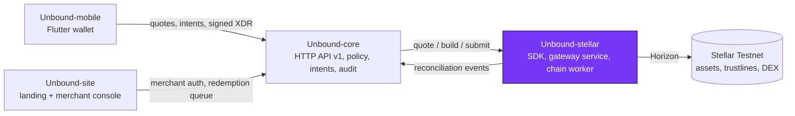

<div align="center">


# Unbound-stellar

**The Stellar-native layer of Unbound: trustline and issuer checks, strict-send path quotes, unsigned transaction builders, submission and ledger reconciliation.**

[](https://github.com/Unbound224/Unbound-stellar/actions/workflows/ci.yml)
[](./LICENSE)
[](https://developers.stellar.org/docs/networks)
[](#project-status)

Part of **[Unbound](https://github.com/Unbound224)** - turn stranded value into something usable.

</div>

## What is Unbound?

Store credit is usually stuck inside one retailer. Unbound lets a person exchange store credit that a retailer has
**genuinely issued and agreed to honor** for other Stellar assets, at a real order-book quote that they sign on their
own device, or redeem it with the issuer.

- **Issuer-authorized only.** A verified merchant signs a redemption policy with its Stellar issuer key and must
  authorize every holder's trustline. No issuer, no usable credit; arbitrary gift cards are out of scope.
- **No fake liquidity.** Quotes come from real Stellar path payments, expire and carry a minimum-output floor. No route
  means no quote. Unbound never promises a price, liquidity or fiat cash-out.
- **Ledger-truthful.** Nothing is shown as settled until the ledger confirms it; unknown outcomes reconcile by hash.
- **Testnet only today.** Mainnet needs an external security review and legal/compliance work that has not happened.

## This repository

`Unbound-stellar` owns everything that touches the ledger: verifying issuer accounts and flags, checking trustlines and
authorization, finding strict-send paths with a slippage cap and expiry, building **unsigned** transactions (settlement,
trustline authorization, issuance, redemption return), classifying submissions, and indexing confirmations into
versioned reconciliation events for `Unbound-core`. It ships as a TypeScript SDK plus a gateway HTTP service and a
chain worker. Only the Testnet passphrase is accepted.

## Architecture

Unbound is four independently tested repositories with one owner per boundary. This one is highlighted.



Clients never build Stellar transactions, and core never reimplements ledger logic. Details:
[`docs/ARCHITECTURE.md`](./docs/ARCHITECTURE.md) and [`docs/STELLAR_PROTOCOL.md`](./docs/STELLAR_PROTOCOL.md).

## Quickstart

Requires Node 22+.

```bash
npm ci
npm run check                      # lint + typecheck + tests + build
npx tsx scripts/m1-demo.ts         # offline demo: issue, quote, settle, and a refused no-trustline route
```

The demo runs on `SimulatedLedger`, an in-memory **test adapter** that verifies real XDR signatures, sequence numbers
and time bounds; its hashes are not Testnet hashes. The gateway (`npm run gateway`, needs `GATEWAY_TOKEN`) and worker
(`npm run worker`, needs `CORE_URL` + `CORE_TOKEN`) are written and tested over HTTP but have **never been run
against Horizon** (see `.env.example`).

## Project status

Legend: **Built** = implemented and covered by automated tests in this repo. **Not yet** = not started or not verified.

| Capability | Status |
|---|---|
| Exact amount math (integer base units, 7 dp, no floats) | Built |
| Verified-issuer registry, fail-closed on untrusted or malformed assets; issuer flag and trustline checks | Built (on the simulator) |
| Unsigned builders: issuer setup, authorize trustline, issue credit, change trust, redemption return | Built (on the simulator) |
| Strict-send quotes: expiry, slippage cap (<= 10%), min-output floor, tamper-evident id, approved-route filter | Built |
| Settlement builder re-validating freshness, balances, authorization and destination trustline | Built |
| Submit classification (CONFIRMED / FAILED / RECONCILING), reconcile by hash, cursor indexer with replay | Built |
| Gateway service for core (quote, settlement, redemption return, submit, balances) with bearer auth | Built, tested over HTTP on the simulator |
| Chain worker (pending-hash watcher, event sink with retry and dead-letter file) | Built, tested with a stub core |
| Horizon adapters (`HorizonClient`) | Type-checked and mapping-tested only; **never run against Testnet** |
| Real Testnet transaction hashes, account-stream indexing, Soroban, liquidity pools, reserves/liabilities | Not yet |
| Published npm package, Docker image, metrics endpoint, fee sponsorship | Not yet |

## Public boundary

- TypeScript API exported from [`src/index.ts`](./src/index.ts).
- [`schemas/reconciliation-event.v1.json`](./schemas) (generated from zod with `npm run schemas`, snapshot-tested) and
  `fixtures/reconciliation-event.confirmed.v1.json` - consumed by `Unbound-core`.
- `fixtures/gateway/*.json` - gateway contract, byte-identical to core's copy; deterministic XDR fixtures for the mobile decoder.

## The four repositories

| Repository | Owns | Stack | CI |
|---|---|---|---|
| [Unbound-core](https://github.com/Unbound224/Unbound-core) | Backend API: issuers, policies, intents, redemptions, audit | TypeScript, Node 22, SQLite | [](https://github.com/Unbound224/Unbound-core/actions/workflows/ci.yml) |
| [Unbound-stellar](https://github.com/Unbound224/Unbound-stellar) (this repo) | Stellar SDK, gateway service and chain worker | TypeScript, @stellar/stellar-sdk | [](https://github.com/Unbound224/Unbound-stellar/actions/workflows/ci.yml) |
| [Unbound-site](https://github.com/Unbound224/Unbound-site) | Landing page, partner docs and merchant console | Next.js 16, React 19, Tailwind 4 | [](https://github.com/Unbound224/Unbound-site/actions/workflows/ci.yml) |
| [Unbound-mobile](https://github.com/Unbound224/Unbound-mobile) | Flutter consumer wallet | Flutter, Dart, Riverpod | [](https://github.com/Unbound224/Unbound-mobile/actions/workflows/ci.yml) |

## Contributing and Drips Wave

Contributions are welcome. Start with [`CONTRIBUTING.md`](./CONTRIBUTING.md), then pick from the scoped, testable ideas in
[`docs/CONTRIBUTOR_ISSUES.md`](./docs/CONTRIBUTOR_ISSUES.md). Unbound intends to take part in
[Drips Wave](https://docs.drips.network/wave/maintainers/participating-in-a-wave/); that is subject to Drips' review and
limits, and no rewards are promised. Wave issues are opened only once their dependencies and acceptance tests are ready.
Everyone agrees to the [Code of Conduct](./CODE_OF_CONDUCT.md).

## Security

Please report vulnerabilities privately (Security tab, **Report a vulnerability**) as described in
[`SECURITY.md`](./SECURITY.md). The threat model is in [`docs/SECURITY.md`](./docs/SECURITY.md). Testnet only: never use
real funds, real customer data or Mainnet keys with this code.

## Documentation

[`docs/PRD.md`](./docs/PRD.md) (product) · [`docs/SRD.md`](./docs/SRD.md) (requirements, API, states) ·
[`docs/ARCHITECTURE.md`](./docs/ARCHITECTURE.md) · [`docs/TECHNICAL_BUILD.md`](./docs/TECHNICAL_BUILD.md) ·
[`docs/ROADMAP.md`](./docs/ROADMAP.md) · [`docs/BRAND.md`](./docs/BRAND.md) · [`AGENTS.md`](./AGENTS.md) (rules for coding agents).
The canonical copy of the shared docs lives in [Unbound-core](https://github.com/Unbound224/Unbound-core/tree/main/docs).

## License

[MIT](./LICENSE). The Unbound logo in [`brand/`](./brand) is the project's approved identity and is shared by all four
repositories; it has not been trademark-cleared.
